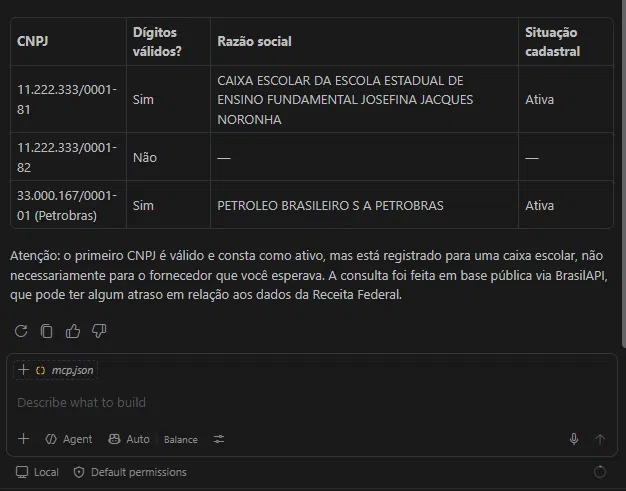

# mcp-brasil

[](https://github.com/adrieldias/mcp-brasil/actions/workflows/ci.yml)


**Servidor MCP em C# que ensina agentes de IA a trabalhar com sistemas brasileiros.**

Conecte ao Claude Desktop, VS Code (Copilot), Cursor ou qualquer aplicativo compatível com o
[Model Context Protocol](https://modelcontextprotocol.io), e o assistente passa a validar e
consultar CNPJ sozinho, decidindo quando cada ferramenta é necessária.

> Você: *Tenho estes CNPJs de fornecedores. Quais são válidos e estão ativos?*
>
> O agente valida cada número localmente, descarta os inválidos sem consultar a Receita,
> consulta os válidos e devolve uma tabela com razão social e situação cadastral.

   

## Ferramentas

| Ferramenta | O que faz | Internet |
|---|---|---|
| `validar_cnpj` | Confere os dígitos verificadores. Suporta o **novo CNPJ alfanumérico**. | Não |
| `consultar_cnpj` | Razão social, nome fantasia, situação cadastral, CNAE, endereço e sócios. | Sim ([BrasilAPI](https://brasilapi.com.br)) |

## Início rápido

Requisitos: [.NET 10 SDK](https://dotnet.microsoft.com/download) ou mais novo.

```bash
git clone https://github.com/adrieldias/mcp-brasil.git
cd mcp-brasil
dotnet pack src/McpBrasil -c Release
dotnet tool install -g McpBrasil --add-source ./nupkg
```

O comando `mcp-brasil` fica disponível no PATH.

### Claude Desktop

Em **Configurações → Desenvolvedor → Editar configuração**, adicione:

```json
{
  "mcpServers": {
    "brasil": { "command": "mcp-brasil" }
  }
}
```

Reinicie o Claude Desktop por completo.

### VS Code (GitHub Copilot)

Abra a pasta do projeto: o arquivo `.vscode/mcp.json` já registra o servidor.
Compile, clique em **Start** no `mcp.json` e use o chat em modo **Agent**.

## Desenvolvimento

```bash
dotnet build McpBrasil.slnx     # compilar
dotnet test McpBrasil.slnx      # testes
npx @modelcontextprotocol/inspector dotnet src/McpBrasil/bin/Debug/net10.0/McpBrasil.dll
```

O [MCP Inspector](https://github.com/modelcontextprotocol/inspector) conecta no servidor e mostra
as mensagens do protocolo (`initialize`, `tools/list`, `tools/call`). No VS Code, as tarefas
`build`, `test` e `inspector` já estão configuradas, assim como a depuração por anexo ao processo.

### Estrutura

```
src/McpBrasil/
  Program.cs                 host, injeção de dependência e transporte stdio
  Tools/CnpjTools.cs         ferramentas expostas via MCP
  Services/CnpjValidator.cs  validação de dígitos (numérico e alfanumérico)
  Services/BrasilApiClient.cs  consulta à BrasilAPI, com resposta resumida
tests/McpBrasil.Tests/       testes automatizados (xUnit)
```

### Princípios de projeto

- **Descrições escritas para o modelo.** O texto de `[Description]` é o que a IA lê para decidir
  quando usar cada ferramenta. É tratado como documentação de API.
- **Respostas enxutas.** Só os campos úteis são devolvidos: menos tokens, menos custo, menos confusão.
- **Erros legíveis.** Falhas viram mensagens claras que o modelo consegue entender e explicar ao usuário.
- **Validação local antes da rede.** Nenhuma consulta externa é feita com um CNPJ inválido.
- **stdout é do protocolo.** Logs vão para o stderr; nunca use `Console.WriteLine` neste projeto.

## Roadmap

- [x] Validação de CNPJ (numérico e alfanumérico)
- [x] Consulta de CNPJ
- [ ] Consulta de CEP
- [ ] Validação de CPF
- [ ] Cache de consultas
- [ ] Publicação no NuGet
- [ ] Versão remota (Streamable HTTP)

## Contribuindo

Issues e pull requests são bem-vindos. Antes de enviar código, rode `dotnet test`.

## Licença

[MIT](LICENSE)
